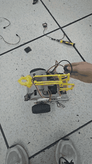
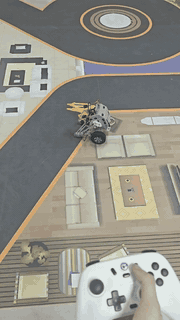

# mini_wheel_legged_four｜小型轮足机器人

这是一个小型轮足机器人项目：用两个轮子行走和保持平衡，用左右腿调节机身高度和侧倾，并搭载舵机机械臂完成抓取。通过 Xbox 蓝牙手柄，可以控制移动、升降、侧倾、跳跃和机械臂。

仓库包含 **STM32 主控程序、ESP32-C3 手柄接收程序、电路与机械设计、仿真模型、控制参数计算脚本和装调资料**。

## 实物演示

| 手柄控制演示 | 场地行走演示 |
| --- | --- |
|  |  |
| [查看原视频](media/f8110322208c3309c1242779aa0f5be6.mp4) | [查看原视频](media/微信视频2026-07-05_232236_349.mp4) |

GIF 保留完整演示过程，缩小尺寸和帧率以便加载；查看清晰、流畅且带声音的版本请打开原视频。

## 能做什么

| 功能 | 通俗说明 |
| --- | --- |
| 自平衡与行走 | 根据机身倾斜、角速度、位移和速度控制轮子，保持平衡并前进、后退 |
| 转向与航向控制 | 左摇杆控制转向，松开横向摇杆后保持目标朝向 |
| 机身升降 | 右摇杆调节两条腿的目标长度，改变机身高度；常规腿长指令范围为 75～183 mm |
| 左右侧倾 | 右摇杆横向控制机身左右倾斜，腿部控制同时补偿侧倾误差 |
| 跳跃 | Share 键触发下蹲、蹬伸、收腿和恢复腿长的动作流程 |
| 腿部支撑与离地判断 | VMC（虚拟模型控制）将腿部所需支撑力换算为关节电机力矩；根据反馈估算支撑力，判断离地状态，双腿均判为离地时轮电机电流指令归零 |
| 机械臂抓取 | 两路舵机控制抬高、降低和前伸、后退，一路舵机控制夹爪；支持行程限位和松手保持位置 |
| 姿态与运动估计 | BMI088 采集角速度、加速度；Mahony 算法计算机身姿态，卡尔曼滤波融合轮速和加速度来估算速度，再积分得到位移 |
| 电机通信与反馈 | 通过 CAN 控制 2 个腿部关节电机和 2 个轮电机，接收位置、速度、电流、温度及错误信息 |
| 无线手柄接收 | ESP32-C3 连接 Xbox 蓝牙手柄，将按键和摇杆数据通过串口发给主控；自动匹配版支持扫描、保存地址和后续重连 |
| 数据查看与调参 | USB 虚拟串口输出惯性数据并接收校准命令；USART1 输出运行数据，并提供串口参数修改入口 |
| 电压与状态提示 | ADC 采集电源电压，任务输出电机错误信息；蜂鸣器提供启动提示，WS2812 灯带及板载指示灯显示灯效 |
| 仿真与参数计算 | Webots 模型用于仿真，MATLAB 脚本计算不同腿长下的 LQR 平衡参数并拟合成主控可用的系数 |

主控采用 **STM32H723VGTx + STM32 HAL + FreeRTOS（CMSIS-RTOS2 接口）**。FreeRTOS 让姿态计算、底盘、腿部、机械臂和通信等任务分别运行。

## 仓库里有什么

两个主要目录：**`robot_main` 是机器人主控代码，`finished` 是配套设计和工具资料。**

```text
mini_wheel_legged_four/
├── robot_main/                   STM32 主控工程
│   ├── Core/
│   │   ├── Inc/、Src/            主程序、外设初始化、任务和中断入口
│   │   └── Work/                 机器人功能代码
│   │       ├── APP/              底盘、腿部、姿态解算和状态观测
│   │       ├── BSP/              电机、手柄、BMI088、PID、舵机和灯带驱动
│   │       ├── mahony/            当前使用的姿态算法
│   │       ├── kalman/            状态估计用的卡尔曼滤波
│   │       ├── EKF/               保留的四元数扩展卡尔曼滤波代码
│   │       └── vofa_base/         保留的 VOFA 调试通信代码
│   ├── MDK-ARM/                  Keil 工程、编译依赖及 CubeMX 修复脚本
│   ├── Drivers/                  STM32 HAL、CMSIS 等底层库
│   ├── Middlewares/              FreeRTOS、USB 等中间件
│   ├── USB_DEVICE/               USB 虚拟串口实现
│   └── robot_main.ioc            CubeMX 外设配置文件
└── finished/                     机械、电路、仿真和装调资料
    ├── hardware/                 主控原理图、PCB、接收机与灯板设计
    ├── 机械/                     结构装配、零件模型、打印件和采购 BOM
    ├── software/
    │   ├── controller/           手柄接收工程、教程和烧录工具
    │   ├── Webots_word/          仿真场景、模型和控制器源码
    │   ├── matlab/               建模、LQR 参数计算和拟合脚本
    │   ├── FOC-hex/              FOC 电机驱动相关文档
    │   └── picture/              电机配置、惯性传感器校准参考图
    ├── 手柄自动匹配/             支持自动扫描与保存手柄地址的接收工程
    ├── MeArm机械臂图纸…/         机械臂模型、打印文件与组装教程
    ├── 轮足BOM.xlsx              机器人物料清单
    ├── 主控陀螺仪校准.docx       惯性传感器校准说明
    └── FOC驱动文档.docx          电机驱动配置说明
```

`finished/` 下还提供 FOC 驱动上位机 HTML 页面、接收机焊接 BOM 和演示视频；`media/` 存放实物照片、演示原视频和 README 使用的 GIF。BOM 是采购物料清单，FOC 驱动负责驱动电机，主控负责计算并发送控制指令。

机械资料中，SolidWorks 文件用于编辑零件和装配，STEP 用于交换三维模型，STL 用于打印，DXF 用于二维加工；电路资料包含 PDF 图纸和 `.epro` 工程。按文件类型选择相应软件打开。

## 第一次看这个项目，从哪里开始

- **想了解机器人**：先看上面的功能表，再看实物照片、演示视频和机械装配模型。
- **想复刻硬件**：先看 [物料清单](finished/轮足BOM.xlsx)、[机械资料](finished/机械/) 和 [电路资料](finished/hardware/)，再看电机驱动与传感器校准文档。
- **想编译或改程序**：从下面的主控编译步骤开始，再按文末的代码入口定位功能。
- **想先跑仿真**：打开 [Webots 场景](finished/software/Webots_word/worlds/miniBH3.wbt)，目录内使用手册标注的版本为 **Webots R2023b**；控制器源码在同目录下的 `controllers/` 中。
- **想调整平衡算法**：查看 [MATLAB 脚本](finished/software/matlab/)，`series_get_k.m` 用于计算、拟合不同腿长的控制增益；脚本使用符号运算和 `lqr`，需要相应 MATLAB 工具箱。

## 编译与运行

### 1. STM32 主控

1. 安装 **Keil MDK、Arm Compiler 6.22** 和 STM32H7 设备支持包；当前工程配置为 `Keil.STM32H7xx_DFP.4.1.3`。
2. 打开 [robot_main.uvprojx](robot_main/MDK-ARM/robot_main.uvprojx)，选择 `robot_main` Target，执行 **Rebuild**（全部重新编译）。
3. 输出位于 `robot_main/MDK-ARM/robot_main/`：`.axf` 用于调试，`.hex` 用于烧录。按主控板调试接口连接下载器，配置 Keil 下载选项后烧录。

以下是必须保留的编译依赖，路径均相对 `robot_main/MDK-ARM/`：

- `FreeRTOS/ARM_CM4F_AC6/port.c` 和 `portmacro.h`：适配 Arm Compiler 6 的 FreeRTOS 移植文件。
- `Lib/ARM/arm_cortexM7lfdp_math.lib`：DSP 数学库；同目录 `.gitignore` 为该库设置了提交例外，也应保留。

**CubeMX** 用于配置引脚、定时器和通信外设，配置入口是 [robot_main.ioc](robot_main/robot_main.ioc)。重新生成代码后，先关闭 Keil 工程，在**仓库根目录**执行：

```powershell
powershell -NoProfile -ExecutionPolicy Bypass -File .\robot_main\MDK-ARM\repair_cubemx.ps1
```

再重新打开工程并 Rebuild。脚本会修复 CubeMX 可能引入的旧版 FreeRTOS 移植文件引用、去掉重复引用并修正 DSP 库路径，不会补下载缺失文件。自定义逻辑应放在生成文件的 `USER CODE BEGIN/END` 区域内。

### 2. ESP32-C3 手柄接收端

STM32 主控不直接连接蓝牙手柄，控制链路是：

```text
Xbox 手柄 ──蓝牙──> ESP32-C3 接收机 ──串口──> STM32 主控 ──CAN──> 电机驱动
                                                 └──PWM──> 机械臂舵机
```

1. 用 PlatformIO 打开 [finished/手柄自动匹配](finished/手柄自动匹配/)，这是一个独立于 Keil 主控工程的接收端工程。
2. 按 `platformio.ini` 使用 `esp32-c3-devkitm-1` 开发板、Arduino 框架和 NimBLE-Arduino 依赖，编译并上传到接收机。
3. 让手柄进入配对模式；没有已保存地址时，程序自动扫描，连接成功后保存地址，下次启动使用该地址连接。
4. 接收端调试串口为 **115200** 波特率，命令以换行结束：`get` 查看已保存地址；`scan` 或 `set` 清除地址并重启；输入 `xx:xx:xx:xx:xx:xx` 格式的地址可手动保存并重启。

接收端向主控发送数据使用 **100000 波特率、8 位数据、偶校验、1 位停止位（8E1）**。自动匹配工程中 TX 为 GPIO0、RX 为 GPIO1；主控使用 UART4（PC11 为 RX、PC10 为 TX），发送端 TX 接接收端 RX，并共地。连接成功有振动提示和指示灯变化，连接失败多次后接收端会重启尝试重连。

### 3. 上电与手柄操作

完成电机驱动配置、接线和传感器校准后，上电先保持机身稳定，等待姿态初始化（约 3 秒）。常规底盘和腿部控制默认未启用；机械臂会自动输出初始姿态。按下再松开 Start 后启用常规控制。

| 操作 | 动作 |
| --- | --- |
| Start（松开时切换） | 启用 / 停用常规底盘、腿部及机械臂按键控制 |
| 左摇杆前后 | 前进 / 后退 |
| 左摇杆左右 | 转向 |
| 右摇杆上下 | 调节腿长，升高 / 降低机身 |
| 右摇杆左右 | 控制机身左右侧倾 |
| Share（松开时触发） | 执行跳跃流程 |
| 方向键 ↑ / ↓ | 机械臂右侧关节抬高 / 降低 |
| 方向键 → / ← | 机械臂左侧关节前伸 / 后退 |
| 按住 RB / LB | 夹爪缓慢夹紧 / 快速张开 |

机械臂松开按键后保持位置；停用后保持当前姿态，重新启用时继续控制。斜向方向键暂停两个机械臂关节，LB、RB 同时按下时夹爪保持位置。Y 键没有绑定夹爪动作。

**当前跳跃分支独立于 Start 常规使能判断，停用常规控制不等于禁止跳跃。** 夹爪没有电流或压力反馈，夹稳后应松开 RB，程序不会自动判断夹持力。

## 调试与参数修改

| 想做什么 | 方法或位置 |
| --- | --- |
| 查看姿态传感器数据 | USB CDC（USB 虚拟串口）每约 500 ms 输出三轴加速度、角速度 |
| 校准 BMI088 | 参考 [校准文档](finished/主控陀螺仪校准.docx)；通过 USB 发送恰好 7 字节的 `imu set`，不附加回车换行。程序暂停姿态任务并输出校准值，需要记录、按文档更新偏置后重新编译烧录并重启，不会自动永久保存 |
| 查看电压和腿部状态 | USART1 调试串口为 **230400、8N1**，当前周期输出电压、腿长变化率、腿长及支撑力；电机错误任务另外输出错误码 |
| 修改串口参数入口 | `freertos.c` 的 `StartDefaultTask()` 提供 DEFS 文本命令解析，包含 `/vmc_pid/`、`/Roll_PID/`、`/TURN_PID/` 等路径；协议实现在 `DEFS_Parser.c` |
| 修改轮子平衡参数 | `chassis_task.c` 的 `Cal_Matrix()` 按腿长计算实际使用的增益；MATLAB 拟合结果需更新到这里。在线 `/K_Matrix/` 入口写入的是另一组变量，当前轮控公式未使用该组变量 |
| 修改腿长、侧倾和跳跃 | `vmc.c` 中的腿长范围、PID 参数和跳跃状态流程 |
| 修改机械臂动作 | `bsp_ext.c` 的 `servo_min`、`servo_max` 和 `SERVO_*_STEP`，分别决定行程边界和每次移动步长 |

机械臂当前参数（PWM 是舵机控制脉冲，下面数值不是角度反馈）：

| 关节 | 主控引脚 / 通道 | 初始值 | 指令范围 | 每约 100 ms 的步长 |
| --- | --- | --- | --- | --- |
| 右侧升降 | PA1 / TIM2 CH2 | 153 | 123～175 | 6 |
| 左侧前后 | PA2 / TIM2 CH3 | 144 | 100～172 | 6 |
| 夹爪 | PA3 / TIM2 CH4 | 150 | 150～195 | 夹紧 3，张开 12 |

每个计数对应 10 μs，可在 Keil Watch 观察 `servo_p[0..2]`。这些范围对应当前装机配置，换舵机或改变安装位置后需要重新标定。

## 读代码时看哪里

| 文件 / 目录 | 负责什么 |
| --- | --- |
| [main.c](robot_main/Core/Src/main.c) | 上电初始化、BMI088 初始化和启动任务调度器 |
| [freertos.c](robot_main/Core/Src/freertos.c) | 创建默认、姿态、底盘、灯效与舵机、状态观测、VMC、电压采集、电机错误和 USB 共 9 个任务 |
| [chassis_task.c](robot_main/Core/Work/APP/Src/chassis_task.c) | Start 状态切换、平衡计算、行走和转向 |
| [vmc.c](robot_main/Core/Work/APP/Src/vmc.c) | 腿部几何解算、支撑力控制、升降、侧倾、离地判断和跳跃 |
| [INS_task.c](robot_main/Core/Work/APP/Src/INS_task.c) | BMI088 采样、Mahony 姿态计算、重力补偿和坐标转换 |
| [observe_task.c](robot_main/Core/Work/APP/Src/observe_task.c) | 轮速与加速度融合，估算速度和位移 |
| [BSP/Src](robot_main/Core/Work/BSP/Src/) | `bsp_motor.c` 电机协议、`bsp_can.c` CAN 收发、`xbox.c` 手柄解析、`bsp_ext.c` 舵机与灯效 |
| [BMI088](robot_main/Core/Work/BSP/BMI088/) | 惯性传感器驱动、校准和偏置参数 |
| [USB_DEVICE](robot_main/USB_DEVICE/) | USB 设备配置、虚拟串口收发 |

当前电机 ID：左腿 **1**、右腿 **2**、左轮 **3**、右轮 **4**，定义在 `chassis_task.h`。当前姿态任务使用 **Mahony**；仓库也保留了 EKF、传统遥控器解析（`rc.c`）和 VOFA 通信代码，保留代码不代表已在当前任务中启用。

## 常见问题

| 现象 | 排查方法 |
| --- | --- |
| 编译报 `__forceinline`、`asm` 或 `PRESERVE8` 错误 | 检查是否引入了旧版 FreeRTOS `port.c`；关闭工程，执行修复脚本后重新打开并 Rebuild |
| 报 `L6002U`，找不到数学库 | 检查 `MDK-ARM/Lib/ARM/arm_cortexM7lfdp_math.lib` 是否存在及工程引用路径 |
| 接收机连不上手柄 | 确认手柄支持相应蓝牙连接并处于配对模式，使用 `get` 查看地址，必要时用 `scan` 清除旧地址重新匹配 |
| 手柄已连接但常规控制无响应 | 检查 UART4 接线、共地和 100000 / 8E1 设置，再确认姿态初始化完成、Start 已切换到启用状态 |
| 想找 FOC 烧录固件 | `FOC-hex` 当前目录提供的是文档；查阅驱动说明和 `hardware/FOC-V4.0.txt` 中的项目来源，不能仅凭目录名认为已有可烧录文件 |
